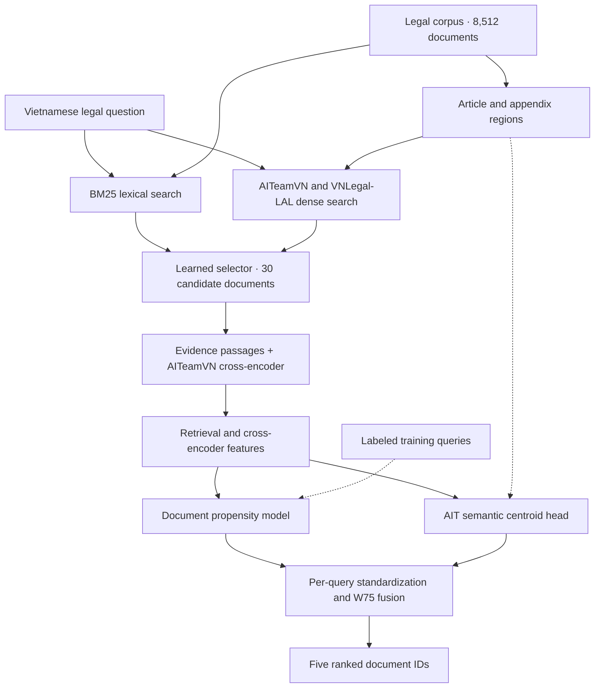

# Vietnamese LegalIR

**7th place · 0.9518 Macro Recall@5 on the private leaderboard**

Vietnamese LegalIR retrieves the five most relevant legal documents for a Vietnamese question. It was built for the Legal Information Retrieval track of UIT Data Science Challenge 2026. Macro Recall@5 measures how much of each question's answer set appears in the top five, then averages across questions.

## Private-stage architecture



### Retrieve and shortlist

The dense retrievers search article and appendix regions at different granularities. Each region maps back to its original document ID. BM25 contributes exact matches on legal terms and references. The selector merges the top results from six channels and learns which combinations of ranks and scores justify keeping a document in the top 30.

### Rerank with legal evidence

Each shortlisted document contributes up to two passages selected for overlap with the question. The AITeamVN cross-encoder reads each question–passage pair, then the strongest passage score represents the document. A logistic model combines this evidence score with the retrieval signals.

### Combine document propensity and semantic similarity

The **propensity model** adds two signals to the retrieval and reranking features. It counts how often a document was a labeled answer and estimates that frequency relative to how often retrieval shortlisted the document. Smoothing makes the estimate more stable for documents with few observations.

The **AIT centroid head** compares the query embedding with a document representation formed by averaging its AITeamVN region embeddings. It uses this comparison and the ranking features to adjust the baseline score for the first 20 candidates.

The **W75 fusion** standardizes each branch's scores within the query. It then combines **75% propensity model score and 25% AIT centroid branch score** and returns the five highest-scoring document IDs.

## Repository layout

```text
.
|-- src/               Retrieval, reranking, and private fusion
|-- reports/           Evaluation protocols and aggregate experiment results
|-- colab/             GPU experiment runners
|-- notebooks/         Colab entry points
|-- artifacts/         Reusable L4 trainer source
|-- research_archive/  Public-phase implementation, write-ups, and tests
|-- data/              Local official snapshot and processed corpus
|-- models/            Local model weights
|-- cache/             Local indexes and generated scores
'-- submissions/       Local prediction files and ZIP packages
```

## Local validation and running the pipeline

The three OOF results below use the same 6,991 evaluable training queries and five grouped folds. Near-duplicate queries stay in the same fold. Each held-out fold uses propensity counts from the other folds.

| Evaluation | Variant | Macro Recall@5 |
| --- | --- | ---: |
| Local OOF | Initial top-30 shortlist order | **93.58%** |
| Local OOF | AITeamVN cross-encoder + retrieval features | 94.26% |
| Local OOF | W75 final fusion | **95.05%** |
| Private leaderboard | Competition result | **95.18%** |

W75 improved local OOF Macro Recall@5 by **1.47 percentage points** over the shortlist order.

Run the commands below from the repository root with Python 3.11 and CUDA. The runners expect the official snapshot under `data/official_v1/`, the processed corpus under `data/evaluation_v2/`, prepared model weights and retrieval indexes, the trained ranking models, and the out-of-fold propensity and centroid scores. Prepare these inputs locally. The repository includes aggregate reports and source code.

```powershell
py -3.11 -m venv .venv
.\.venv\Scripts\python.exe -m pip install -r requirements.txt
.\.venv\Scripts\python.exe src/stage04_private/materialize_endgame_private.py
.\.venv\Scripts\python.exe src/stage07_local/materialize_gold_centroid_private.py
.\.venv\Scripts\python.exe src/stage07_local/run_final_clean_fusion_private.py
```

The final runner exports `GOLD_PROP_AIT_W75_K5.zip` under `submissions/endgame_20260923/` when the local audit selects the 0.75 weight. Pass `--oof-only` to recompute the fusion audit from prepared fold scores.

- [Grouped evaluation protocol](reports/stage00c_evaluation_protocol_v2/REPORT.md) · [Shortlist and reranking results](reports/stage03b1_aiteam_reranker/REPORT.md) · [W75 fusion audit](reports/stage07y_final_clean_fusion/FUSION_AUDIT.json)
- [Private-phase code](src/) · [Private experiment reports](reports/) · [Public-phase archive](research_archive/legalir_public_phase/)
